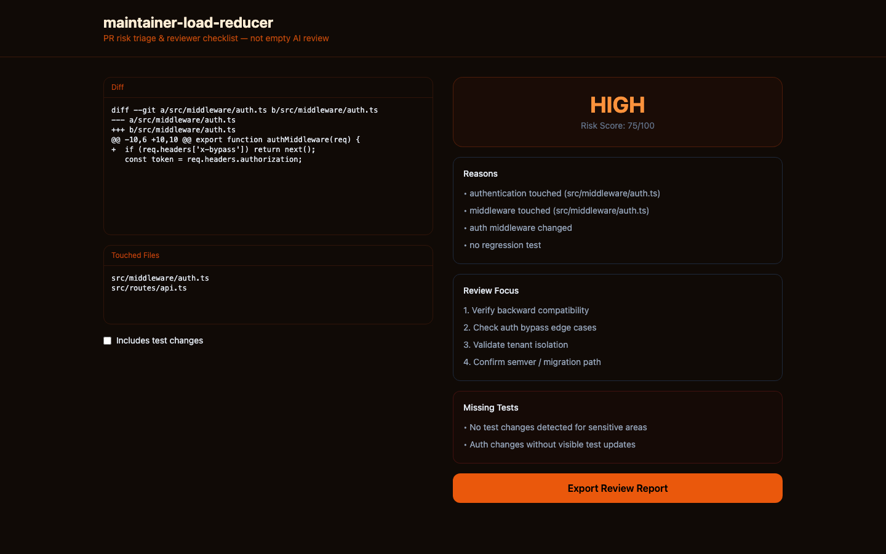

# maintainer-load-reducer

> PR risk triage for maintainers — reviewer checklist, missing tests, and breaking-change flags.

**Topics:** `open-source` · `code-review` · `github` · `maintainer` · `pull-requests` · `devtools` · `oss`



## Features

- Analyze PR diff + touched files
- Risk level + reviewer focus checklist
- Missing tests, breaking changes, rollback concerns

## Quick Start

```bash
npm install
npm run dev      # http://localhost:3106
npm test
```

## License

MIT — see [LICENSE](LICENSE).

## Author

**Mehmet Turac** — [github.com/mturac](https://github.com/mturac)
